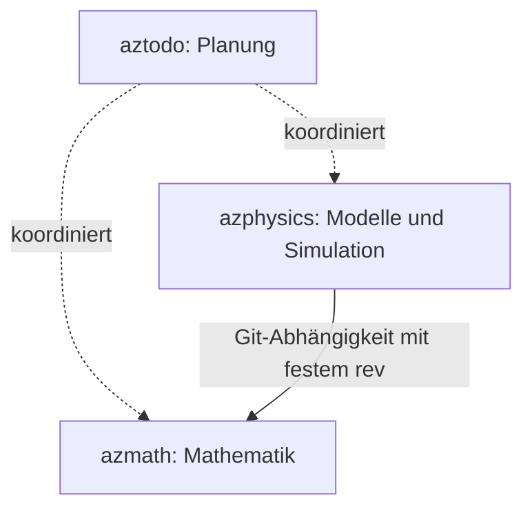

# Zuständigkeit und Abhängigkeiten

## Repository-Grenzen

**azmath:** Zahlen/Trait-Backends, lineare Algebra, Nullstellen, Optimierung,
Differentiation, Quadratur, Statistik, allgemeine ODE/PDE-Diskretisierung und
mathematische Geometrie. Parameter sind mathematische Größen, keine versteckten
Materialgesetze oder physikalischen Einheiten.

**azphysics:** Zustände und Einheitenkonventionen, Kräfte und Materialmodelle,
physikalische Randbedingungen, Druckprojektion, Partikel-Gitter-Transfers,
APIC/FLIP, XPBD und Simulationsabläufe. Mathematische Algorithmen werden aus
azmath verwendet und dort verbessert, wenn sie allgemein formulierbar sind.

**aztodo:** Planung und Entscheidungen. Es ist keine Cargo-Abhängigkeit.

azmath hängt nicht von azphysics ab. azphysics bindet azmath direkt per Git und
festem `rev` ein: `75c5dc04c51ddf02568f15f4ab3c46f7ba4c2c7c` (AZP-002).
`default-features = false` verhindert ein ungewolltes std-Backend; std, libm,
micromath und alloc werden durch die entsprechenden azphysics-Features
weitergereicht. Cargo.lock wird mit versioniert. Die ersten Punktmassenmodelle
(AZP-010/020) verwenden azmath-Verlet und ergänzen physikalische Parameter,
SI-Zustände sowie Energie-/Impulsdiagnostik. Analytische Referenzen und
Schrittweiten-/Zeitumkehrtests laufen in CI. Ein zusätzlicher Oszillatorvergleich
prüft Verlet gegen Gauss–Legendre-RK4; das Modell-API delegiert weiterhin an Verlet.

## Zuordnung der gewünschten Verfahren

| Wunsch | Allgemeiner Baustein in azmath | Anwendung in azphysics |
|---|---|---|
| LU, QR, Cholesky, SVD | Faktorisierungen, Rang, Kondition, Refinement | Systeme der jeweiligen Modelle aufstellen |
| CG, GMRES, BiCGSTAB, MINRES | LinearOperator, Abbruchkriterien, Vorkonditionierer | Passenden Operator und physikalische Daten liefern |
| Newton, LM, BFGS | Gleichungen, Ausgleichsrechnung, Optimierung | Modellresiduen und Ableitungen formulieren |
| Brent / Chandrupatla | Skalare Nullstellensuche | Zustandsgleichungen und Ereignisse |
| APIC / FLIP + Druck-PCG | Interpolation, Sparse-Operatoren, PCG, Multigrid | Transfers, Massenerhaltung, Druckgleichung und Wände |
| XPBD | Generische Algebra, Differentiation, ggf. allgemeine Projektionslöser | Nachgiebige Zwangsbedingungen, inverse Massen, Kontaktreaktionen |
| BVH / Spatial Hash | Allgemeine Geometrie; endgültige Paketgrenze noch GEO-001 | Kontaktkandidaten und Nachbarschaftssuche |
| Verlet | Separable Hamilton-Systeme, Schrittfunktionen | Kräfte, Massen und Zustände |
| Gauss–Legendre | Quadratur und implizites RK4 vorhanden (AZM-031) | Strukturtreue zeitliche Integration geeigneter Modelle |

## Konkretisierung der nächsten Schnittstellen

- GEO-001 entscheidet anhand von Abfragen, Datenbesitz und alloc-Bedarf die
  Modulgrenze; AZP-030 Spatial Hash und AZP-031 BVH sind getrennte Pakete.
- AZP-021 formuliert physikalische Kräfte und Dämpfung. Allgemeine ODE-Löser
  bleiben in azmath; geschwindigkeitsabhängige Kräfte passen nicht automatisch
  zum Vertrag des ortsabhängigen Verlet-Lösers.
- AZP-040 enthält nur XPBD-Distanzbedingungen; räumliche Suche wird erst für
  Kontakte in AZP-041 benötigt.
- AZM-040 liefert mathematische Operatoren/Nullraumbehandlung; AZP-051 ergänzt
  Dichte, Einheiten, MAC-Gitter und physikalische Wandbedingungen.
- AZP-022 bewertet spätere Einheitentypen und Partikellayouts; die bisherigen
  SI-Konventionen bleiben gültig. Einzelheiten: [Arbeitspakete](docs/ARBEITSPAKETE.md).

## Wichtige fachliche Voraussetzungen

- PCG ist für symmetrisch positiv definite Systeme bestimmt. Bei reinem Neumann-
  Druckproblem müssen Konstante/Nullraum und Kompatibilität der rechten Seite
  behandelt werden; das ist keine Aufgabe für „einfach mehr Iterationen“.
- MINRES behandelt symmetrisch-indefinite Systeme; der Vorkonditionierer muss
  zu den mathematischen Anforderungen des Verfahrens passen.
- Verlet setzt in der ersten Ausbaustufe `H(q,p)=T(p)+V(q)` voraus. Allgemeine
  geschwindigkeitsabhängige Kräfte werden nicht stillschweigend unterstützt.
- XPBD-Compliance und Zeitschritt gehören zur physikalischen Formulierung.
  Ein allgemeiner Matrixlöser kennt diese Bedeutung nicht.
- Ein algorithmischer Kurztest ersetzt keine physikalische Validierung:
  Referenzlösung, Erhaltungssätze, Konvergenzordnung und Randbedingungen müssen
  für das konkrete Modell geprüft werden.
