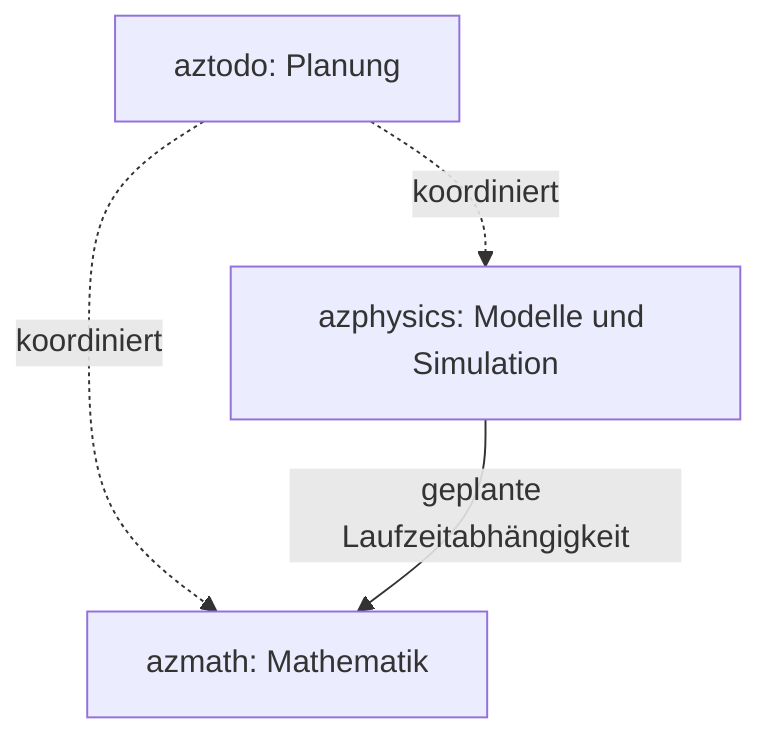

# Zuständigkeit und Abhängigkeiten

## Repository-Grenzen

**azmath:** Zahlen/Trait-Backends, lineare Algebra, Nullstellen, Optimierung,
Differentiation, Quadratur, Statistik, allgemeine ODE/PDE-Diskretisierung und
mathematische Geometrie. Parameter sind mathematische Größen, keine versteckten
Materialgesetze oder physikalischen Einheiten.

**azphysics:** Zustände und Einheitenkonventionen, Kräfte und Materialmodelle,
physikalische Randbedingungen, Druckprojektion, Partikel-Gitter-Transfers,
APIC/FLIP, XPBD und Simulationsabläufe. Mathematische Algorithmen werden aus
azmath verwendet und dort verbessert, wenn sie allgemein formulierbar sind.

**aztodo:** Planung und Entscheidungen. Es ist keine Cargo-Abhängigkeit.

azmath hängt nicht von azphysics ab. Das Physik-Gerüst hat zunächst keine
azmath-Cargo-Abhängigkeit; sie wird für das erste reale Modell mit geprüftem
Commit bzw. später einer veröffentlichten Version eingeführt. Damit behauptet
leerer Gerüstcode keine bereits funktionsfähige Integration.

## Zuordnung der gewünschten Verfahren

| Wunsch | Allgemeiner Baustein in azmath | Anwendung in azphysics |
|---|---|---|
| LU, QR, Cholesky, SVD | Faktorisierungen, Rang, Kondition, Refinement | Systeme der jeweiligen Modelle aufstellen |
| CG, GMRES, BiCGSTAB, MINRES | LinearOperator, Abbruchkriterien, Vorkonditionierer | Passenden Operator und physikalische Daten liefern |
| Newton, LM, BFGS | Gleichungen, Ausgleichsrechnung, Optimierung | Modellresiduen und Ableitungen formulieren |
| Brent / Chandrupatla | Skalare Nullstellensuche | Zustandsgleichungen und Ereignisse |
| APIC / FLIP + Druck-PCG | Interpolation, Sparse-Operatoren, PCG, Multigrid | Transfers, Massenerhaltung, Druckgleichung und Wände |
| XPBD | Generische Algebra, Differentiation, ggf. allgemeine Projektionslöser | Nachgiebige Zwangsbedingungen, inverse Massen, Kontaktreaktionen |
| BVH / Spatial Hash | Allgemeine Geometrie; endgültige Paketgrenze noch GEO-001 | Kontaktkandidaten und Nachbarschaftssuche |
| Verlet | Separable Hamilton-Systeme, Schrittfunktionen | Kräfte, Massen und Zustände |
| Gauss–Legendre | Quadratur vorhanden; implizites RK geplant | Strukturtreue zeitliche Integration geeigneter Modelle |

## Wichtige fachliche Voraussetzungen

- PCG ist für symmetrisch positiv definite Systeme bestimmt. Bei reinem Neumann-
  Druckproblem müssen Konstante/Nullraum und Kompatibilität der rechten Seite
  behandelt werden; das ist keine Aufgabe für „einfach mehr Iterationen“.
- MINRES behandelt symmetrisch-indefinite Systeme; der Vorkonditionierer muss
  zu den mathematischen Anforderungen des Verfahrens passen.
- Verlet setzt in der ersten Ausbaustufe `H(q,p)=T(p)+V(q)` voraus. Allgemeine
  geschwindigkeitsabhängige Kräfte werden nicht stillschweigend unterstützt.
- XPBD-Compliance und Zeitschritt gehören zur physikalischen Formulierung.
  Ein allgemeiner Matrixlöser kennt diese Bedeutung nicht.
- Ein algorithmischer Kurztest ersetzt keine physikalische Validierung:
  Referenzlösung, Erhaltungssätze, Konvergenzordnung und Randbedingungen müssen
  für das konkrete Modell geprüft werden.
