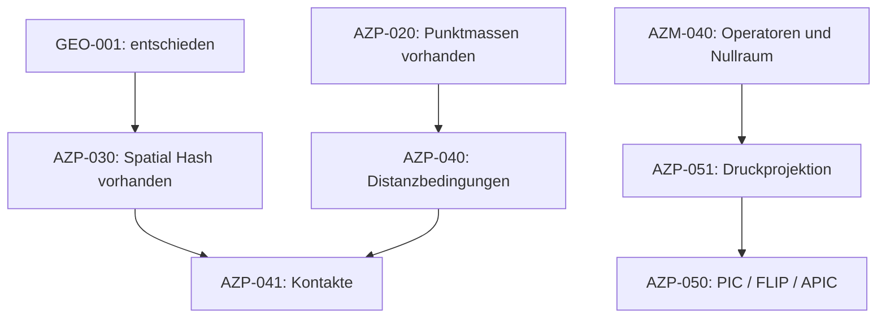

# Gemeinsame Roadmap

Stand: 2026-11-07. Diese Horizonte beschreiben Prioritäten, keine Termine.
[BACKLOG.md](BACKLOG.md) ist der vollständige Aufgabenindex;
[Details](docs/ARBEITSPAKETE.md) und [Abnahmeregeln](docs/ABNAHME.md)
legen prüfbare Ergebnisse und Grenzen fest. Code-/CI-Nachweise: [STATUS.md](STATUS.md).

## Abgeschlossen

- PLAN-001/002: zentrale Planung, Archiv und präzisierte Arbeitspakete.
- AZM-001: Verteilungen/Quantile mit direkten oberen Tails und Referenzen.
- AZM-010/020: technische Release-Vorbereitung und MINRES/PMINRES.
- AZM-030/031: Verlet und zweistufiges implizites Gauss–Legendre-RK4.
- AZP-001/002: Physik-Gerüst, feste Git-Abhängigkeit und Feature-Weiterleitung.
- GEO-001/AZP-030: Paketentscheidung D-012 und dynamischer 2D/3D-Spatial-Hash
  mit stabilen IDs, atomaren Updates und Brute-Force-Referenztests.
- AZP-010/020: SI-Konventionen, Punktmassenmodelle und analytische Referenztests;
  zusätzlicher GL4-/Verlet-Vergleich vorhanden.

AZM-010 ist keine crates.io-Veröffentlichung. AZM-011 bleibt eine separat
beauftragte Entscheidung. Vorhandene Gauss–Legendre-Quadratur und RK4-Integrator
sind unterschiedliche mathematische Werkzeuge.

## Als nächster Umsetzungsschritt empfohlen

1. **AZP-040 XPBD-Distanzbedingungen:** Teilchen mit inversen Massen,
   Compliance/dt², fixierten Punkten und einem klaren Lambda-Vertrag.
2. **AZP-041 Kontakte:** nach der XPBD-Basis mit dem vorhandenen Spatial Hash;
   zunächst reibungsfrei und mit Brute-Force-/Bilanzreferenzen.
3. **AZP-031 BVH:** getrennte spätere Alternative, wenn AABB-/Objektabfragen den
   Bedarf zeigen. Allgemeine Primitive in azmath, dynamischer Index in azphysics.

Das ist die empfohlene Reihenfolge, keine Behauptung bereits begonnener
XPBD-Implementierung. GEO-001 und Spatial Hash sind abgeschlossen; BVH und
XPBD bleiben offen. Ein kleines Distanzmodell benötigt weder AMG noch eine BVH.

## Abhängigkeiten der nächsten Modellschritte

AZP-031 BVH kann den Spatial Hash für geeignete Kontaktabfragen ersetzen;
ein geprüfter Index genügt. Die Pfeile zeigen notwendige Grundlagen, nicht
sämtliche Kriterien eines Pakets.

## Kurzfristig begleitend: Qualität und erste Modellbausteine

- QUAL-001: Testmatrix und gezielte f32-/Backend-/Vorkonditioniererlücken.
- QUAL-002: vorhandene Fuzz-/Property-Tests erweitern, besonders ODE;
  existierende FFT-/Sparse-/special-/QP-Targets weiterverwenden.
- QUAL-003: aktuelle Coverage auswerten und wichtige Fehlerpfade schließen.
- QUAL-004: reproduzierbare Benchmark-Baseline; harte Grenzwerte erst nach
  Messung von Streuung und Festlegung geeigneter Hardware.
- AZP-021: kombinierbare Kräfte, Federn und korrekt integrierte Dämpfung.
  AZP-022 entscheidet bei konkretem Bedarf Einheitentypen und Partikellayout.

Qualitätspakete sind endliche, separat abnehmbare Verbesserungen. Die normalen
Abnahmeregeln gelten ohnehin für jede neue Funktion; eine gesamte Qualitätsliste
muss nicht vor jedem einfachen Physikmodell abgeschlossen werden.

## Mittelfristig: steife Dynamik und Druckprojektion

- AZM-032: eingebetteter Radau-Fehlerschätzer; AZM-033: begründet ausgewähltes
  Rosenbrock-Paar. Zuerst Quellen/Koeffizienten und Referenzfälle, dann Implementierung.
- AZM-040: generische 2D-Poisson-Ränder und Nullräume; danach AZP-051:
  physikalische Druckprojektion auf einem 2D-MAC-Gitter.
- AZM-041: P1-FEM-Neumann-/Robin-Ränder. Höhere Ordnung ist separat AZM-043.
- AZM-050: SQP-Wiederherstellung; Maratos-Korrektur nach reproduzierbarem Bedarfsfall.

## Langfristig: Transfers, größere Verfahren und Materialmodelle

- AZP-050: PIC → FLIP → APIC getrennt testen, danach mit AZP-051 koppeln.
  Erste Stufe 2D/konstante Dichte; freie Oberflächen und 3D später abgrenzen.
- AZM-042: AMG erst bei belegtem Skalierungsbedarf; AZM-043: zunächst P2-FEM.
- AZM-060: reelle Schur-/Eigenvektoren und Ritz-Paare; AZM-070: weitere komplexe
  Sparse-Verfahren; AZM-080: breitere Referenz-/Genauigkeitsbereiche.
- AZP-060: IAPWS-Bestand und Materialzuständigkeit entscheiden. AZP-070:
  SPH/weitere Strömung/Thermodynamik vor Umsetzung in konkrete Modellpakete aufteilen.
- AZM-021: Chandrupatla nur bei messbarem Nutzen gegenüber vorhandenem Brent.

Weitere Ideen verbleiben im [Archiv](docs/archive/azmath-roadmap-2026-11-06.md).
Vor einer Implementierung bekommen sie eine eigene ID, Zuständigkeit,
Voraussetzungen, Grenzen und Abnahme. „Bewusst ausgelassen“ ist ein Hinweis
auf mögliche Arbeit, keine dauerhafte Einschränkung.
